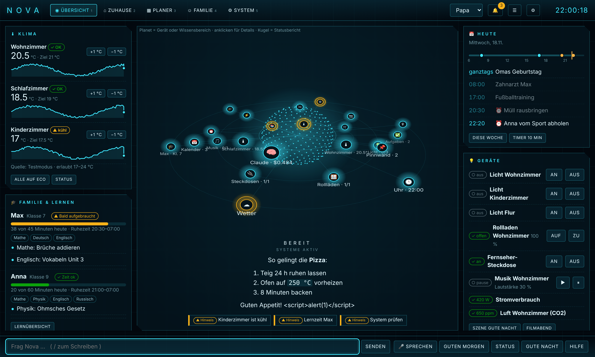

<p align="center">
  
</p>

<h1 align="center">Nova</h1>

<p align="center"><b>Your family's AI assistant at home – works online or completely offline.</b></p>

<p align="center">Runs on your own Windows PC or Linux computer. With a cloud AI when you want it, and fully on your home network when there is no internet.</p>

<p align="center">
  <a href="../../releases/latest"></a>
  
  
  
  
</p>

<p align="center">
  
</p>

## What it does

- 🧠 **Answers and helps** – ask by voice or text: the calendar, homework, the shopping list, to-dos, reminders, the weather and the rooms at home.
- 🔌 **Works offline** – once a local AI model is installed, Nova keeps working on your home network with no internet at all.
- 🏠 **Runs at home** – on your own Windows PC or Linux computer. Nothing is sent to a company unless you choose a cloud AI.
- 🗣️ **Voice, fully local** – speech recognition (Whisper) and a natural voice (Piper) run on the device; no audio leaves the house.
- 👨‍👩‍👧‍👦 **Made for the family** – study-time limits for children, quiet hours, a shared pin board, and a futuristic screen (HUD) everyone can read.
- 🔒 **Asks before it acts** – changing the heating or a device always needs a clear confirmation; every change can be undone.
- 🌍 **Three languages** – German, English and Russian.

## Download

| System | File |
|---|---|
| Windows 10/11 (64-bit) | portable `Nova-Windows-portable.zip` from the [latest release](../../releases/latest) |
| Linux (Intel/AMD, x86-64) | portable `Nova-Linux-portable.tar.gz` from the [latest release](../../releases/latest) |

The builds are **portable**: unpack and start, no installation. Every version is published as a release tag (`v1.x.x`).

> Tested on Windows and on 64-bit Linux (Intel/AMD). A Raspberry Pi build is planned but **not tested yet**.

**Check your download** (optional):

```
sha256sum -c SHA256SUMS
```

## Made for home

- For private use in your own home, not for companies (see the [license](LICENSE)).
- Results and answers are a help, not a guarantee – check anything important yourself.
- For a physical action (heating, devices) Nova always asks first.

---

<p align="center">
  Freeware, use at your own risk:
  <a href="LICENSE">License</a> ·
  <a href="PRIVACY.md">Privacy</a> ·
  <a href="DISCLAIMER.md">Disclaimer</a> ·
  <a href="SECURITY.md">Security</a>
</p>

<p align="center">© 2026 v98881</p>
